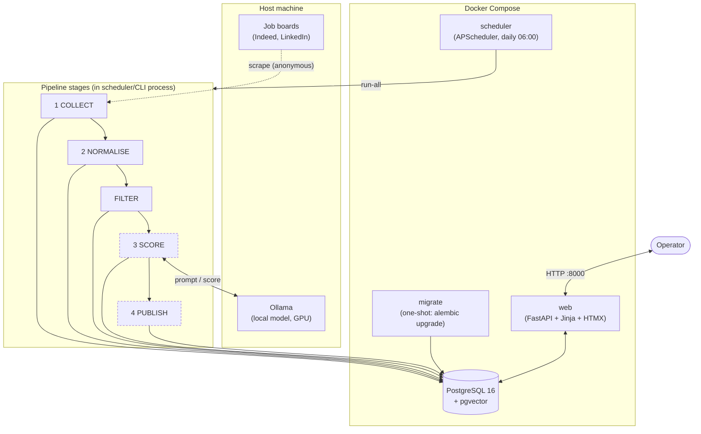
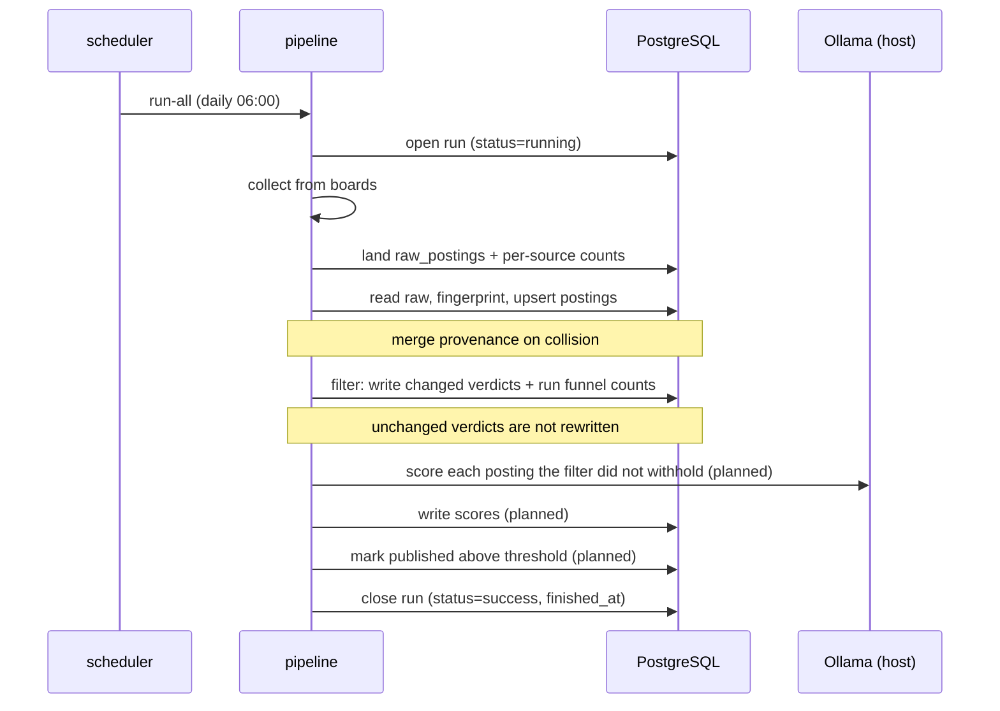

# Design Document — System Architecture
## Automated Job Discovery Pipeline

| | |
|---|---|
| **Version** | 1.1 |
| **Date** | 19 November 2026 — filter step added (ADR-0016, ADR-0017, ADR-0018, ADR-0020) |
| **Status** | Approved |
| **Related** | [SRS](../software-requirements-specification.md), [Data Model](data-model.md), [Design record](../job-discovery-pipeline-design.md) |

---

## 1. Overview

The system is a four-stage pipeline executed once daily, with a filter step
between normalisation (stage 2) and scoring (stage 3) and a web interface over
the resulting data. Stages communicate only through a PostgreSQL staging
database; none calls another directly. Each stage is independently re-runnable
and idempotent, and data flows in one direction (design §7.1).

The staging database is the central design decision. It establishes an
idempotency boundary with three consequences (design §7.2):

1. A failure in a later stage does not cost an earlier stage's work.
2. Filtering can be re-applied across the whole corpus after a criteria
   change, and scoring after a prompt change, without re-collecting.
3. Rejected postings persist, preventing recurrence.

---

## 2. Component view

Stages 3 and 4 (dashed) are specified but not yet implemented. The filter is
implemented (§5.2a). It is not a numbered stage: it is D6's title pre-filter,
taken out of stage 3 so that it could run before scoring exists, and the stage
numbers are unchanged.

---

## 3. Runtime topology

The system runs as four containers from one image plus the stock PostgreSQL
image (ADR-0004, tech-stack T2).

| Service | Image | Lifetime | Role |
|---|---|---|---|
| `postgres` | `pgvector/pgvector:pg16` | Long-running | Staging database and durable store |
| `migrate` | `job-discovery:latest` | One-shot | Applies migrations to head, then exits |
| `scheduler` | `job-discovery:latest` | Long-running | Fires `run-all` daily |
| `web` | `job-discovery:latest` | Long-running | Serves the triage interface |

Startup ordering is enforced by Compose: `postgres` must be healthy, then
`migrate` must exit successfully, before `web` and `scheduler` start. This
removes the race in which two long-running services might apply migrations
concurrently.

**Ollama runs on the host, not in a container**, so it can use the host GPU
directly. The application containers reach it at `host.docker.internal:11434`.

---

## 4. Package structure

The application is one Python package, `app`, organised by responsibility.

| Package | Responsibility | Depends on |
|---|---|---|
| `app.config` | Typed settings from environment/`.env` | — |
| `app.collect` | Stage 1: query boards via JobSpy | JobSpy |
| `app.normalise` | Fingerprinting: country, employer, title | JobSpy (country enum) |
| `app.filters` | Relevance and experience criteria (D6, ADR-0016, ADR-0018) | — |
| `app.db` | SQLAlchemy models, session management, and the read-time seams | SQLAlchemy, `filters` |
| `app.services` | Settings, profiles, blacklist, triage, read models, reports | `db`, `filters` |
| `app.pipeline` | Stage orchestration and persistence; `filter_stage.py` is the only writer of a verdict | `collect`, `normalise`, `filters`, `db`, `services` |
| `app.web` | FastAPI interface | `services`, `db`, FastAPI |
| `app.scheduler` | APScheduler daily trigger | APScheduler |
| `app.__main__` | Typer CLI wiring the above together | all |

The dependency direction is strict: `normalise`, `collect` and `filters` know
nothing of the database; `pipeline` composes them and persists; `web` reads the
database only. Fingerprint and criteria logic are pure functions over strings,
testable without any infrastructure.

Unlike `collect` and `normalise`, `filters` has more than one consumer. The
pipeline evaluates the criteria to record verdicts. `services.queries`
evaluates them again to explain a rejection in the interface (FR-017).
`db.attribution` resolves the contributing profiles into criteria inputs. Each
of them calls the same pure functions, so the reasons the interface shows
cannot disagree with the verdicts the pipeline stored.

`app.db` holds the read-time seams — `visibility.py` (what is withheld, and
why) and `attribution.py` (which run and profile surfaced a posting) — rather
than `app.services`, because `pipeline` may not import `services` and the
pipeline stages are seam consumers. A seam sited where a consumer cannot reach
it is a seam that consumer will reimplement (ADR-0015, ADR-0016).

---

## 5. Stage design

### 5.1 Stage 1 — Collect

Queries each configured board for each search specification through JobSpy.
Search specifications are explicit rather than a term × location product, because
JobSpy's `country_indeed` parameter takes one country per call (design D14).

A board failing raises no exception out of the stage: the error is recorded
against the run and the remaining boards proceed (SRS FR-4). The complete
collector output is landed verbatim in `raw_postings`; no field is discarded at
this stage, so a later schema decision costs a backfill rather than a
re-collection.

A subtle failure shape is handled explicitly: a total board failure returns a
DataFrame with no columns (shape `(0,0)`), not merely no rows. The stage checks
for emptiness before touching columns, converting a would-be crash into a
recorded empty result.

### 5.2 Stage 2 — Normalise

Reads the run's landed rows, derives a fingerprint per row, and upserts one
`postings` record per fingerprint. The fingerprint is
`sha256(normalised_employer | normalised_title | location_token)`, where the
location token is the ISO country code, `REMOTE`, or `UNKNOWN`.

Where several boards surface the same role, each board's URL is merged into the
posting's `sources` map rather than creating a second record. The stage is
idempotent: reprocessing the same rows converges on the same postings.

The normalisation rules trade a tolerable failure for an intolerable one
throughout (design §7.3): showing one posting twice is a nuisance; concealing a
posting behind a false merge is a lost opportunity. Employer normalisation is
therefore conservative (suffixes only), title normalisation retains
seniority/discipline, and an unresolvable country becomes `UNKNOWN` rather than a
guess.

### 5.2a Filter — relevance and experience

Implemented in `pipeline/filter_stage.py` over the pure criteria in
`app.filters`. `runner._run()` calls it straight after normalisation, so every
entry point that runs the pipeline also runs the filter: `run-all`, each
profile's scheduled run, and the web "run now". It can also be run on its own
with `filter`.

This is D6's filter **extracted from stage 3**, not a renumbering of the
pipeline. There were three reasons. Stage 3 does not exist yet. The run counters
would have stayed unwritten until it did. And re-applying changed criteria
without re-collecting needs a standalone entry point anyway (`filter --all`).
When stage 3 is built it will read the filter's verdict, not contain the filter.

**Criteria.** Each posting is judged on two criteria, and each gets its own
verdict.

| Criterion | Input | Rule |
|---|---|---|
| Title | Global include/exclude patterns (`/settings`), plus each contributing profile's own (`/profiles`) | `all_of(global, any_of(profiles))`. The global rule always applies and no profile can loosen it. Exclude beats include. (ADR-0018) |
| Experience | The requested level on each profile that surfaced the posting, against the posting's seniority | The posting is admitted if *any* contributing profile admits it. A request admits its own level and everything below it. |

The posting's seniority comes from the board's declared `job_level` where there
is one (LinkedIn). Where the board declares none (Indeed), it comes from a
conservative reading of the title. A plainly titled posting is unknown, and
unknown admits (ADR-0017, ADR-0020).

The contributors are **every profile that has ever surfaced the posting**,
resolved by `db.attribution`, not the profile of the run being filtered. If the
verdict were taken from `run.profile_id`, it would depend on which run was
filtered last and would alternate between runs instead of settling. Disjunction
is order-independent, so the verdict settles regardless of order. A run with no
profile (a manual `run-all`) imposes no requirement.

**Writes.** The stage writes two things:

- On `postings`, two tri-state verdict columns, `title_filter_passed` and
  `experience_filter_passed`. `NULL` means the criterion was not applied,
  `TRUE` means admitted, and `FALSE` means rejected.
- On the run being filtered, the funnel counters `runs.filter_passed_count` and
  `runs.filter_rejected_count`. Together they sum to the run's
  `deduplicated_count`.

It never writes a triage status, `last_retrieved_at` or a landed row. A verdict
records what the criteria say, and a triage status records what the operator
decided. The stage keeps the two apart.

**Enforcement is at read time.** Nothing is deleted or re-statused. The
interface's read models apply `db.visibility.hidden_by_filter()`, which matches a
posting that is rejected *and still untriaged*. A later tightening of the
criteria therefore never withdraws a posting the operator has already
shortlisted or applied to. `db.visibility.filter_rejected()`, which ignores
triage status, backs the *filtered out* view, and that view derives the grounds
for each rejection on demand rather than storing them (§6).

**Re-application.** `filter --all` evaluates every posting under the current
criteria without contacting a board (FR-011). This is how a criteria change
reaches postings already collected, and how a withheld posting comes back with
its triage status intact. It writes no run counters, because a corpus-wide
re-application belongs to no single run. Every write is guarded by a comparison,
so a re-application under unchanged criteria writes nothing and leaves
`updated_at` alone (SC-007). The command reports how many verdicts changed, and
on a second pass that number is zero. `--dry-run` reports the same figures and
writes nothing.

**Failure behaviour.** The filter fails open.

- An empty pattern or a blank experience level disables that criterion.
- A malformed pattern disables itself and rejects nothing.
- An unreadable experience value counts as no requirement.

Each of these faults is logged and also appended to `runs.error`, where the
runs view shows it. A partial run under-filters rather than over-filters. When
the filter rejects every posting in a run, it logs a warning so that the empty
result is not mistaken for a board that has stopped responding.

See [ADR-0016](../ADRs/0016-collect-stage-filter-verdicts.md) and
[ADR-0018](../ADRs/0018-per-profile-title-rules.md), and the operations guide
for how to set the criteria.

### 5.3 Stage 3 — Score **(planned)**

Scores each posting the filter admitted against the CV through a locally hosted
instruction-tuned model via Ollama. Output — score, matched skills, gaps,
rationale — is validated against a Pydantic schema before storage; malformed
output is rejected. The producing model is recorded with the score.

**Seam obligation (ADR-0015, ADR-0016):** the candidate query must apply
`db.visibility.not_suppressed()` **and** `~db.visibility.hidden_by_filter()`
when selecting postings to score, and the scored-count written to `runs` must be
scoped the same way. Scoring a blacklisted employer's postings, or postings the
operator's own criteria turned away, is wasted model time — the reduction in
model invocations D6 exists for.

### 5.4 Stage 4 — Publish **(planned)**

Marks postings at or above the threshold as published, which is what surfaces
them in the interface. After ADR-0004 this is a database state transition, not a
write to any external service.

**Seam obligation (ADR-0015):** this is where FR-009 (a blacklisted employer's
postings are never published) now lives. `db.visibility.not_suppressed()`
must be applied both when selecting candidates for publication and when
writing `run.published_count` — nothing else in the pipeline excludes a
suppressed employer's postings from this stage.

---

## 6. Interface design

The web interface is server-rendered (FastAPI + Jinja2), with HTMX for the status
transition so a triage action does not reload the page. It has no build step and
shares the application image and the same Python runtime as the pipeline
(tech-stack T2).

| Route | Purpose |
|---|---|
| `GET /` | Overview: totals, triage breakdown, source-health sparklines |
| `GET /postings` | Ranked, filterable, searchable list. Withholds what the filter turned away while it is still untriaged (ADR-0016) |
| `GET /postings?verdict=rejected` | What the filter turned away, with the criterion that did it (FR-017) |
| `GET /postings/{id}` | Detail: description beside assessment; source links |
| `POST /postings/{id}/status` | Triage transition (HTMX fragment, or redirect without) |
| `GET /runs` | Per-source trend and run history (the §7.4 review surface) |
| `GET /healthz` | Liveness plus database reachability |

Read models live in `app.services.queries`, separate from the route handlers, so the
querying is testable without a web client and templates receive plain data rather
than ORM rows.

Status transitions degrade gracefully: the control posts a normal form when HTMX
is absent, and the endpoint redirects rather than returning a bare fragment when
the request is not an HTMX request.

---

## 7. Data flow and idempotency

Idempotency is enforced per stage: collection appends to an append-only landing
zone keyed by run; normalisation upserts by fingerprint; the filter overwrites
a posting's verdict only when it differs; scoring and publication are keyed by
posting. A crash leaves the run at `running`, which is itself the
signal that the process died (SRS FR-32).

---

## 8. Observability

Per-run, per-stage counts are persisted to the `runs` table, and per-source
counts to `runs.counts_by_site`. The dominant failure mode is not an error but a
run that exits successfully while a source silently returns less over time. The
aggregate collected count hides this; the per-source series exposes it. The
interface renders that series as the primary content of the overview and runs
views, and weekly review of it is a required operating procedure (Operations
Guide §4).

The filter adds two counts to each run, *passed* and *rejected*. Both the runs
view and `status` show them. A run the filter never evaluated shows `—` instead
of `0`, because `0` would claim the filter admitted nothing. Read the two counts
with `counts_by_site`. A falling *passed* count with a steady *collected* count
means the criteria are rejecting more. A falling *collected* count means a board
is returning less. Filter criteria faults are recorded on `runs.error` beside
board failures (§5.2a).

---

## 9. Technology summary

| Concern | Choice | Reference |
|---|---|---|
| Language / runtime | Python 3.12 | tech-stack |
| Dependency management | uv (locked) | tech-stack T3 |
| Collection | JobSpy | D2 |
| Store | PostgreSQL 16 + pgvector | D4 |
| ORM / migrations | SQLAlchemy 2.0 / Alembic | T1 |
| Scoring | Ollama, 7–8B instruction model | D5, D8 |
| Interface | FastAPI + Jinja2 + HTMX | ADR-0004 |
| Scheduling | APScheduler (in container) | T2 |
| Packaging | One image, four services | ADR-0004 |

---

## 10. Known constraints and future work

- **Vector search** is provisioned but unused: the pgvector extension is enabled
  in the initial migration though no column requires it yet, to avoid a migration
  whose only purpose is the extension (design §14, phase 2).
- **Single machine.** There is no horizontal scaling story and none is required.
- **Cross-board deduplication** is proven on live data but has been exercised on
  only a small volume; its behaviour at scale accrues as the corpus grows.

*End of document.*
